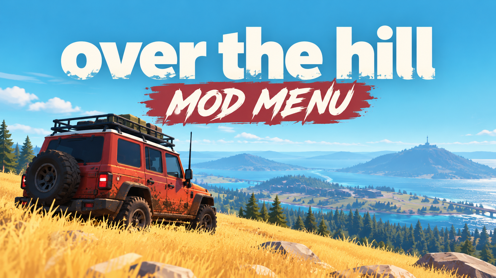

# over the hill — Mod Menu

**A proper photo mode first. Then: no damage, infinite winch, unlock every vehicle and portal, weather and time control, four-player recovery.**

    

> **[⬇️ Download the latest over the hill mod menu](../../releases/latest)**

    

[Camera](#camera-first) · [Driving](#the-vehicle) · [World](#the-world) · [Questions](#questions)

---

> [!NOTE]
> Co-op for up to four, PvE, no racing against anyone and no leaderboards. Settings marked **`crew`** change the shared world; host-only mode blocks them for guests by default.

## Camera first

Every other page like this buries the camera section at the bottom. For a Funselektor game that is the wrong order.

*over the hill* is from the people who made Art of Rally, and the thing Art of Rally is still remembered for — years later, in screenshot threads — is how it looks when you stop driving and turn the camera around. This one has day-night cycles, weather, biomes built from real places, and a minimalist art style that photographs beautifully at almost any hour. A million people put it on a wishlist largely on the strength of its trailers.

So the camera settings come first here, because for a lot of people they are the entire reason to install anything.

| Setting | Key | Scope |
|---|---|---|
| Free camera, unlimited range | <kbd>F1</kbd> | Client |
| Camera speed `0.1x`–`10x` | slider | Client |
| Hide interface | <kbd>F2</kbd> | Client |
| Field of view `50`–`130 deg` | slider | Client |
| Time of day, any hour | slider | **`crew`** |
| Freeze the clock | <kbd>F3</kbd> | **`crew`** |
| Weather override | dropdown | **`crew`** — clear, overcast, rain, fog, snow |
| Fog density `0%`–`200%` | slider | Client |
| Depth of field and focus pull | sliders | Client |
| Disable motion blur | — | Client |
| Hide your own vehicle | — | Client |
| Tilt and roll the horizon | slider | Client |

Time and weather are `crew` because the world is shared. If three friends are halfway up a ridge in daylight, do not set it to midnight for a photo.

## The vehicle

Rugged 1960s-to-1980s off-roaders, fitted with tools, driven over terrain that genuinely fights back.

| Setting | Key | Scope |
|---|---|---|
| No vehicle damage | <kbd>F4</kbd> | Client |
| Infinite fuel | <kbd>F5</kbd> | Client |
| Unbreakable winch cable | <kbd>F6</kbd> | Client |
| Winch strength `1x`–`20x` | slider | Client |
| Winch range `10`–`200 m` | slider | Client |
| Engine power `0.5x`–`5x` | slider | Client |
| Tyre grip `0.5x`–`10x` | slider | Client |
| Suspension travel `0.5x`–`3x` | slider | Client |
| Never flip | — | Client |
| Instant right-side-up | <kbd>F7</kbd> | Client |
| Unstick and reposition | <kbd>F8</kbd> | Client — see the warning |
| Vehicle mass `0.3x`–`3x` | slider | Client |
| Unlock all vehicles and tools | — | `save` |

> [!WARNING]
> **Getting stuck is the content.** The winch exists because the game expects a river crossing to go wrong. Picking a line, reading the slope, failing, rigging a recovery and crawling out is the loop — not an interruption to it.
>
> **Unstick and reposition** skips all of that. It is genuinely useful when the terrain traps you somewhere the game did not anticipate, and genuinely corrosive if you bind it to a thumb button. Treat it as a bug workaround, not a driving aid.

## The world

| Setting | Key | Scope |
|---|---|---|
| Unlock all portals and regions | — | `save` |
| Reveal the full map | <kbd>F9</kbd> | Client |
| Highlight collectibles `20`–`500 m` | slider | Client |
| Highlight trail objectives | — | Client |
| Teleport to a map marker | <kbd>F10</kbd> | Client |
| Complete trail challenges | — | `save` |
| Terrain deformation `0x`–`3x` | slider | **`crew`** — how deeply you rut the mud |
| Water depth `0.5x`–`2x` | slider | **`crew`** |
| Gravity `0.3x`–`2x` | slider | **`crew`** |

## Co-op

| Setting | Key | Scope |
|---|---|---|
| Teleport to a friend | — | Client |
| Tow a stranded friend from range | <kbd>F11</kbd> | **`crew`** — the generous one |
| See teammates through terrain | — | Client |
| Share unlocked regions | — | **`crew`** |
| Convoy camera | — | Client — frames all four vehicles |

Towing somebody out from across a valley is the one setting here that makes you a better person to play with. The rest are for you.

## Keys

<kbd>Insert</kbd> menu · <kbd>End</kbd> reset everything · <kbd>F1</kbd> free camera · <kbd>F2</kbd> hide HUD · <kbd>F3</kbd> freeze time · <kbd>F4</kbd> no damage · <kbd>F5</kbd> fuel · <kbd>F6</kbd> winch · <kbd>F7</kbd> flip upright · <kbd>F8</kbd> unstick · <kbd>F9</kbd> reveal map · <kbd>F10</kbd> teleport · <kbd>F11</kbd> tow a friend

Everything rebinds. Full controller support is in the game itself; the menu is keyboard and mouse.

## Two ways to use this

**For photographs:** free camera, hide interface, freeze the clock at golden hour, fog density around 140%, depth of field on. Nothing about the driving changes. This is the configuration most people will actually keep.

**For a relaxed drive:** infinite fuel, unbreakable winch, winch strength 3x. You still get stuck, you still have to rig the recovery and pick a tree worth anchoring to — you simply stop losing a run to a snapped cable thirty metres from the top.

The one to leave alone on a first playthrough is **unstick and reposition**. Everything else can be walked back; a habit of teleporting out of trouble cannot.

## Questions

Any risk to my account?

None to speak of. There is no competitive mode, no timed ladder and no anti-cheat. It is four people and some hills.

Does it have a photo mode beyond the game's own?

That is the main thing it adds, yes — unlimited free-camera range, manual focus pull, horizon tilt, fog density, and the ability to hide your own vehicle, none of which the built-in camera offers.

Will changing the weather annoy my friends?

It might, which is why time and weather are marked <code>crew</code> and blocked for guests. The world is shared. Ask before you turn a sunny ridgeline into a blizzard.

Does the winch strength setting break the physics?

Past about 8x, yes — the vehicle starts behaving like it is on a rail rather than a rope, and anchor points can fail in odd ways. Around 3x is the sweet spot for making recoveries forgiving without making them trivial.

Console versions?

Console releases are planned for 2027. This is Windows PC only and will stay that way; console builds cannot run tools like this at all.

Settings stopped working after an update.

Memory addresses move when the game patches, and settings fail individually rather than together. Check your build against the release notes, or turn on read-only mode to see which values the menu still reads correctly.

Flagged by antivirus.

Reading another process's memory is what this tool does and also what a lot of genuinely nasty software does, so scanners cannot tell the difference and flag the category. A checksum ships with each release and the source is right here. Whether you add an exclusion is entirely up to you.

## If something goes wrong

Most of it comes down to where you are when you toggle. World settings bind once a region is loaded, so nothing happens on the main menu or during a portal transition. Vehicle settings bind to whatever you are currently driving — swap trucks and re-toggle. Co-op settings need an active session, not a lobby.

If the menu will not open, something else owns <kbd>Insert</kbd> — Steam's overlay and Discord are the usual pair. If terrain deformation is cranked and the frame rate dropped, that is the game simulating mud rather than a problem with the menu; turn it back toward 1x.

[Open an issue](../../issues) when something is genuinely broken. Lead with the **game build number**, then host or guest, which region, which vehicle, and the single setting that misbehaved.

## Version history

**1.0.0** — 18 October 2026 — first build, four days after launch. 40+ settings across Camera, Vehicle, World, Co-op and Menu. Host-only mode and rolling backup on by default.

---

Unofficial fan tool with no connection to Funselektor, Strelka Games or Valve. over the hill and its assets are theirs. Editing a running process can crash it or corrupt a save, so keep backups and go in knowing that. MIT licence.

